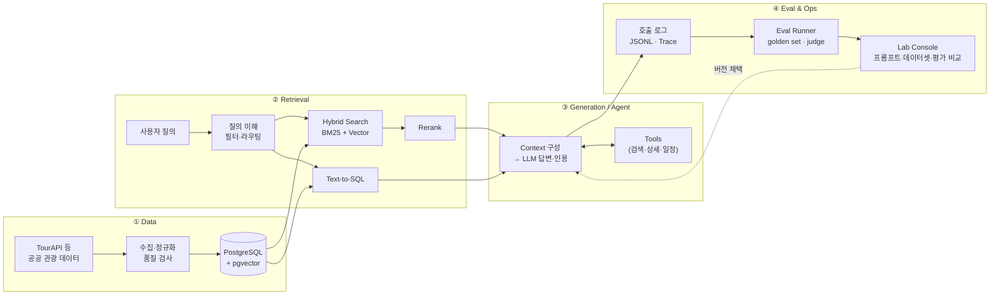

# 🧭 Travel AI Engineering Lab

관광 도메인에서 **검색 · RAG · Agent** 시스템을 직접 만들고, **평가로 개선을 증명하는** LLM 애플리케이션 엔지니어링 실험실입니다.

> 기능을 붙이는 것보다 **"이 변경이 정말 나아졌는가?"를 숫자로 답하는 것**을 목표로 합니다.
> 모든 설계 결정은 **품질 · 지연 · 비용** 세 축의 측정 결과와 함께 기록합니다.

---

## 이 Lab이 답하려는 질문

| # | 질문 | 다루는 곳 |
| --- | --- | --- |
| Q1 | 한국어 관광 질의에서 **어떤 검색 방식**이 근거 문서를 가장 잘 찾는가? (BM25 · 벡터 · 하이브리드 · 리랭킹) | Retrieval |
| Q2 | 검색 결과를 **어떻게 구성해야** 답변이 근거를 벗어나지 않는가? (chunking · context 수 · 인용 형식) | Generation |
| Q3 | 근거가 없을 때 **모르겠다고 말하게** 할 수 있는가? (abstention) | Generation |
| Q4 | LLM이 **도구를 정확하고 일관되게** 쓰게 하려면 도구를 어떻게 설계해야 하는가? | Agent |
| Q5 | 결과가 매번 다른 시스템에서 **개선 효과를 어떻게 증명**하는가? (반복 측정 · 신뢰구간 · 판정자 검증) | Evaluation |
| Q6 | 품질을 지키면서 **지연과 비용을 얼마나 줄일 수 있는가?** (캐싱 · 모델 라우팅 · 스트리밍) | Ops |
| Q7 | 외부 문서에 숨은 지시(**간접 prompt injection**)를 어디서 막아야 하는가? | Safety |

---

## 시스템



모든 단계는 **교체 가능한 인터페이스**로 분리해, 한 부분만 바꿔 끼우고 같은 평가셋으로 비교합니다.

| 컴포넌트 | 인터페이스 | 비교 구현체 (Variants) |
| --- | --- | --- |
| Chunker | `chunk(doc) -> list[Chunk]` | 고정 길이 · 문단 · 필드 기반(제목+주소+개요) |
| Embedder | `embed(texts) -> vectors` | 상용 API · bge-m3 · KURE |
| Retriever | `search(query, filters, k)` | PostgreSQL FTS · BM25(형태소) · pgvector · 하이브리드(α 가중합 / RRF) |
| Reranker | `rerank(query, docs)` | 없음 · cross-encoder · LLM 리랭크 |
| LLM Provider | `complete()` / `stream()` | 상용 모델 2종 · 오픈 웨이트(로컬) |
| Orchestrator | `run(task)` | 고정 workflow · 직접 구현 agent loop · LangGraph |

---

## 평가 체계 (Eval Stack)

검색과 생성을 **분리해서** 측정해야 문제가 어디서 생겼는지 알 수 있습니다.

| 층위 | 무엇을 보나 | 지표 | 방법 |
| --- | --- | --- | --- |
| **Retrieval** | 필요한 문서를 찾았나 | Recall@k · MRR · nDCG@k | golden query set (질문 → 관련 문서 ID) |
| **Generation** | 근거대로 답했나 | Faithfulness · Answer relevancy · Citation accuracy · Abstention 정확도 | LLM-as-judge + 사람 라벨 검증 |
| **Agent** | 도구를 맞게, 매번 쓰나 | Tool 선택·인자 정확도 · Task 성공률 · **pass^k** · 평균 step | 시나리오 테스트 케이스 × k회 반복 |
| **Safety** | 공격에 버티나 | 공격 성공률(ASR) · 오거부율 | 직접·간접 injection 테스트 셋 |
| **System** | 빠르고 싼가 | p50/p95 latency · TTFT · TPOT · 요청당 비용 · 캐시 적중률 | 호출 로그 집계 |

**평가의 신뢰도도 함께 잽니다**
- 같은 입력을 **k회 반복**해 성공률과 분산을 본다 (LLM은 비결정적).
- 평가 문항이 적으면 **95% bootstrap 신뢰구간**을 적고, 같은 문항끼리 짝지어 비교한다.
- LLM 판정자는 사람 라벨과의 **Cohen's κ**로 검증한 뒤에만 자동 평가에 쓴다.
- 평가셋은 버전을 매기고, 프롬프트 튜닝에 쓴 예시는 평가셋에 넣지 않는다.

---

## Lab Console (LLMOps 도구)

평가 체계를 직접 다루는 사내 도구입니다. 프롬프트·데이터셋·평가 결과를 버전으로 관리하고, **버전끼리 지표를 비교해 채택 여부를 결정**합니다.
FastAPI(`/ops/*`)가 로직을, worker가 평가 실행을, Next.js가 화면을 맡고 PostgreSQL에 기록합니다. 로드맵에 맞춰 v1 → v3로 확장합니다.

→ 설계: [docs/console.md](docs/console.md)

---

## 실험 기록

모든 실험은 같은 형식으로 남기고(`docs/experiments/`), 채택한 결정은 ADR로 정리합니다(`docs/adr/`).

```
Question   →  Hypothesis  →  Variants (A vs B)  →  Fixed (dataset·model·prompt 버전)
→ Metrics (품질 · 지연 · 비용)  →  Result  →  Decision
```

| ID | 질문 | 비교 | 결과 요약 | 결정 |
| --- | --- | --- | --- | --- |
| EXP-001 | 수집은 어떤 동시성 모델이 적합한가 | 동기 · 스레드 · asyncio | _진행 예정_ | |
| EXP-002 | 한국어 관광 문장에 맞는 임베딩은 | 상용 API · bge-m3 · KURE | _진행 예정_ | |
| EXP-003 | 구조화 출력은 어떤 방식이 안정적인가 | 프롬프트 JSON · structured output · tool 인자 | _진행 예정_ | |
| EXP-004 | 도구 설명이 호출 정확도에 주는 영향 | 짧은 설명 · 상세 설명 | _진행 예정_ | |
| EXP-005 | 하이브리드 검색의 가중치는 | BM25 · Vector · α 스윕 · RRF | _진행 예정_ | |

> 결과가 쌓이면 이 표가 Lab의 핵심 산출물이 됩니다.

---

## 로드맵

| 단계 | 핵심 질문 | 만드는 것 | 측정 기반 |
| --- | --- | --- | --- |
| **0. 기초** | 어떻게 재고, 어떻게 비교하나 | 측정 모듈 `bench.py` · 관측 가능한 LLM 호출 래퍼 | latency 분포 (p50 · p95) |
| **0.5 단순 RAG** | 일단 끝까지 돌아가는가 | 장소 100개 · 임베딩 · 코사인 top-5 · LLM 답변 — 이후 모든 실험의 **기준선** | 직접 질문 20개로 눈 평가 |
| **1. 데이터** | 믿을 수 있는 지식베이스인가 | 스키마 · 수집·정규화 파이프라인 · baseline을 PostgreSQL+pgvector로 이전 | 품질 규칙 실패율 · 멱등성 |
| **2. 검색** | Q1 | BM25 → 벡터 → 하이브리드 · 리랭킹 · golden set · **Console v1** (데이터셋·평가 기록·결과 비교) | Recall@k · MRR · nDCG · 검색 지연 |
| **3. RAG·앱** | Q2 · Q3 | 인용형 QA API · 스트리밍 채팅 화면(Next.js) · SQL 라우팅 · 배포 · **Console v2** (프롬프트 버저닝·RAG 평가자) | Faithfulness · Citation · TTFT |
| **4. Agent·안전** | Q4 · Q7 | 일정 생성 agent · 공격 테스트 셋 · 가드레일 | Task 성공률 · pass^k · ASR |
| **5. 평가·운영** | Q5 · Q6 | 합성 평가셋 · CI 품질 게이트 · **Console v3** (운영 대시보드) · 캐싱·라우팅 | goodput · 요청당 비용 · 회귀 감지 · 신뢰구간 |

---

## 디렉토리 (계획)

```
travel-ai-lab/
├── apps/
│   ├── api/               # FastAPI (/ask, /search, /ops/* Console API)
│   ├── worker/            # 평가 실행 worker (PostgreSQL job 큐)
│   └── web/               # Next.js — 채팅 화면 + /console (바이브코딩)
├── packages/
│   ├── ingest/            # 수집·정규화
│   ├── retrieval/         # chunker · embedder · retriever · reranker
│   ├── generation/        # LLM provider · prompt · 인용 처리
│   ├── agent/             # tools · orchestrator
│   ├── evaluation/        # metrics · evaluators · runner · judge (api·worker 공용)
│   ├── registry/          # 프롬프트·데이터셋·평가 실행 버전 관리 (PostgreSQL ops 스키마)
│   └── shared/            # bench · logging · config
├── migrations/            # DB 스키마 마이그레이션
├── prompts/               # 프롬프트 초안 (채택본은 registry에 버전으로 등록)
├── data/evaluation/       # golden set · 테스트 케이스 (버전별)
├── docs/                  # console 설계 · 기술 지도
├── docs/experiments/      # 실험 노트
├── docs/adr/              # 설계 결정 기록
└── tests/
```

## 기술 스택

**Python · uv** / FastAPI · Pydantic / PostgreSQL · pgvector / LLM API (structured output · streaming · tool calling) / sentence-transformers / Next.js (프론트엔드 · 바이브코딩) / pytest · Ruff · Pyright / Docker · GitHub Actions / OpenTelemetry

같은 역할을 하는 대안 기술과 각 개념의 설명은 **[docs/tech-landscape.md](docs/tech-landscape.md)** 에 정리했습니다.

> 프레임워크를 먼저 쓰지 않고 직접 구현하는 이유: 각 부품이 무엇을 하는지 이해한 뒤, **같은 평가셋에서 프레임워크와 비교해** 도입 여부를 숫자로 결정하기 위해서입니다.

## 시작하기

```bash
uv sync
uv run python main.py
```
