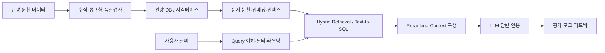

# 🧭 Travel AI Engineering Lab

관광 도메인을 대상으로 **데이터 수집 → 검색 → LLM·RAG → Agent → 평가·운영**까지 LLM 애플리케이션 전 과정을 직접 설계하고 실험하는 프로젝트입니다.

LLM 기능을 붙이는 데서 끝내지 않고, **검색 품질·답변 근거성·응답 시간·비용을 측정하고, 그 수치로 설계 결정을 설명하는 것**을 목표로 합니다.

## 주요 내용

| 영역 | 내용 |
| --- | --- |
| **관광 지식베이스** | 공공 관광 데이터를 수집·정규화하고 출처·수집일·라이선스·갱신 이력을 함께 관리 |
| **하이브리드 검색** | BM25(한국어 형태소 분석) + 벡터 검색 + 지역·기간·카테고리 필터 + 리랭킹 |
| **인용형 RAG** | 근거 문서를 인용해 답하고, 근거가 부족하면 "확인 필요"로 답을 보류 |
| **질의 라우팅** | 질의를 문서 검색 / 구조화 데이터 질의(Text-to-SQL) / 직접 답변으로 분기 |
| **Agent** | tool calling 기반의 제한된 여행 일정 생성 agent |
| **안전성** | prompt injection(직접·간접) 공격 테스트와 가드레일, tool 최소 권한 |
| **평가 체계** | golden query set으로 검색(Recall@k, MRR, nDCG)과 답변(정확성·근거성)을 따로 평가하고 CI 회귀 테스트로 운영 |
| **LLMOps** | latency(p50/p95, TTFT)·토큰 비용·캐시 적중률·tracing 관측 |

## 아키텍처



### 설계 원칙

- **검색과 생성을 분리해서 측정** — Retriever 품질과 Generator 품질을 각각 평가한다.
- **근거 우선 응답** — 출처 없는 사실은 확정적으로 말하지 않는다.
- **교체 가능한 컴포넌트** — chunker, embedder, retriever, reranker, generator를 인터페이스로 분리해 실험 단위로 바꿔 끼운다.
- **측정 가능한 변경** — 모든 실험은 가설·데이터셋·설정·결과를 함께 기록하고, 주요 결정은 ADR로 남긴다.

## 기술 스택

| 영역 | 기술 |
| --- | --- |
| Language | Python, uv |
| Data | PostgreSQL, Pydantic |
| Search | PostgreSQL FTS, pgvector |
| LLM | LLM API (structured output, streaming, tool calling), embedding model |
| App | FastAPI, Streamlit |
| Eval / Test | pytest, golden set, LLM-as-judge |
| Ops | Docker, GitHub Actions, OpenTelemetry |

## 로드맵

| Phase | 내용 | 주요 결과물 |
| --- | --- | --- |
| 1. 데이터 | 관광 데이터 모델링, ETL, end-to-end 뼈대 | 스키마·데이터 사전, 적재 파이프라인, `/ask` API |
| 2. 검색 | BM25 → 벡터 검색 → 하이브리드·리랭킹 | golden query set, chunking·검색 방식 비교 실험 |
| 3. RAG·앱 | 인용형 답변, 멀티턴, SQL 라우팅 | 인용형 QA API, 스트리밍 UI, 배포 |
| 4. Agent·안전 | tool use agent, 보안 테스트 | 일정 생성 agent, 공격 테스트 셋, 가드레일 |
| 5. 평가·운영 | 평가 harness, LLMOps | CI 회귀 평가, 비용·품질 대시보드 |

## 시작하기

```bash
uv sync
uv run python main.py
```

