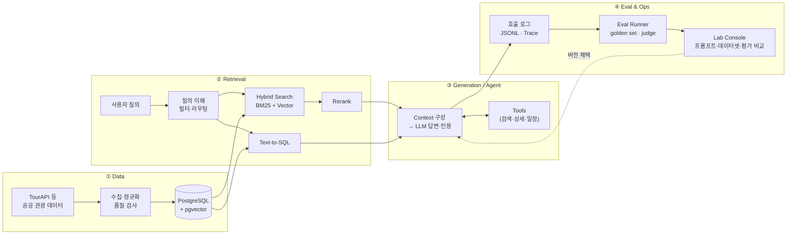

# 🧭 Travel AI Engineering Lab

관광 도메인을 대상으로 **데이터 → 검색 → LLM·RAG → Agent → 평가·운영**까지 LLM 애플리케이션의 전 과정을 직접 설계하고, 기술을 비교 실험하는 개인 학습·실험 저장소입니다.

기능을 붙이는 데서 끝내지 않고, **"이 변경이 정말 나아졌는가?"를 품질 · 지연 · 비용 세 축의 숫자로 답하는 것**을 목표로 합니다.
모든 기술 선택은 같은 평가셋 위에서 **A vs B 비교 실험**을 거친 뒤 결정하고, 그 근거를 실험 노트와 ADR로 남깁니다.

> **상태:** 학습 진행 중 (W00-1). 아래 기술과 구조는 **학습·비교 실험 대상**이며, 이미 구현했다는 의미는 아닙니다.
> 공공 관광 데이터(TourAPI 등)만 사용하며, 운영 서비스와 분리된 독립 환경에서 실험합니다.

---

## Research Questions

이 Lab의 모든 실험은 아래 질문 중 하나에 답하기 위해 진행합니다.

| # | 질문 | 영역 |
| --- | --- | --- |
| Q1 | 한국어 관광 질의에서 **어떤 검색 방식**이 근거 문서를 가장 잘 찾는가? (BM25 · 벡터 · 하이브리드 · 리랭킹) | Retrieval |
| Q2 | 검색 결과를 **어떻게 구성해야** 답변이 근거를 벗어나지 않는가? (chunking · context 수 · 인용 형식) | Generation |
| Q3 | 근거가 없을 때 **모르겠다고 말하게** 할 수 있는가? (abstention) | Generation |
| Q4 | LLM이 **도구를 정확하고 일관되게** 쓰게 하려면 도구를 어떻게 설계해야 하는가? | Agent |
| Q5 | 결과가 매번 다른 시스템에서 **개선 효과를 어떻게 증명**하는가? (반복 측정 · 신뢰구간 · 판정자 검증) | Evaluation |
| Q6 | 품질을 지키면서 **지연과 비용을 얼마나 줄일 수 있는가?** (캐싱 · 모델 라우팅 · 스트리밍) | Ops |
| Q7 | 외부 문서에 숨은 지시(**간접 prompt injection**)를 어디서 막아야 하는가? | Safety |

---

## Topics & Technologies

**굵게** 표시한 기술이 출발점이고, `→` 뒤는 같은 평가셋에서 비교할 후보입니다. 프레임워크보다 직접 구현을 먼저 해서 각 부품이 무엇을 하는지 이해한 뒤, 도입 여부를 숫자로 결정합니다.

| Category | Technologies |
| --- | --- |
| Language & Data | **Python 3.12 · uv · NumPy · Pydantic · PostgreSQL** · pytest · Ruff · Pyright |
| Keyword Search | **PostgreSQL FTS** → Elasticsearch/OpenSearch(nori) · Kiwi 형태소 분석 |
| Embedding · Vector | **상용 API · bge-m3 · KURE + pgvector** → multilingual-e5 · Cohere · Voyage / Qdrant · Milvus · Chroma · FAISS |
| Reranking | **cross-encoder** → Cohere Rerank · LLM 리랭크 |
| LLM · Structured Output | **상용 LLM API + 직접 구현 Provider · Pydantic structured output** → LiteLLM · Ollama/vLLM · Instructor · Outlines |
| RAG · Agent | **직접 구현 workflow·agent loop · function calling** → LangGraph · LlamaIndex · LangChain · MCP |
| Evaluation | **직접 구현 eval runner · LLM-as-judge** → Ragas · DeepEval · promptfoo |
| Observability | **JSONL 로그 · OpenTelemetry** → Langfuse · LangSmith · Arize Phoenix |
| Safety | **직접 구현 규칙 기반 가드레일** → Guardrails AI · NeMo Guardrails · Llama Guard |
| LLMOps (Lab Console) | **직접 구현 Console — FastAPI `/ops` + PostgreSQL `ops` 스키마 + 평가 worker** → Langfuse · LangSmith · promptfoo |
| Application · Infra | **FastAPI · Next.js(바이브코딩) · Docker Compose · GitHub Actions** → Streamlit · Vercel AI SDK · Redis |

같은 역할을 하는 대안 기술과 각 개념의 설명은 [docs/tech-landscape.md](docs/tech-landscape.md)에 정리했습니다.

---

## Architecture



- **baseline부터 한 변수씩:** 가장 단순한 RAG(장소 100개 → 임베딩 → 코사인 유사도 top-5 → LLM 답변)를 먼저 완성하고, 이후 모든 실험은 이 버전을 기준선으로 삼아 한 부분씩 바꿔 개선합니다.
- **검색과 생성을 분리해서 측정:** 답이 틀렸을 때 검색 문제인지 생성 문제인지 구분할 수 있어야 합니다.
- **근거 우선 응답:** 출처 없는 사실은 확정적으로 말하지 않고, 근거가 부족하면 "추가 확인 필요"로 답을 보류합니다.

각 단계는 교체 가능한 인터페이스로 분리해, 한 부분만 바꿔 끼우고 같은 평가셋으로 비교합니다.

| 컴포넌트 | 인터페이스 | 비교 구현체 (Variants) |
| --- | --- | --- |
| Chunker | `chunk(doc) -> list[Chunk]` | 고정 길이 · 문단 · 필드 기반(제목+주소+개요) |
| Embedder | `embed(texts) -> vectors` | 상용 API · bge-m3 · KURE |
| Retriever | `search(query, filters, k)` | PostgreSQL FTS · BM25(형태소) · pgvector · 하이브리드(α 가중합 / RRF) |
| Reranker | `rerank(query, docs)` | 없음 · cross-encoder · LLM 리랭크 |
| LLM Provider | `complete()` / `stream()` | 상용 모델 2종 · 오픈 웨이트(로컬) |
| Orchestrator | `run(task)` | 고정 workflow · 직접 구현 agent loop · LangGraph |

---

## Evaluation Stack

검색과 생성을 **분리해서** 측정해야 문제가 어느 단계에서 생겼는지 알 수 있습니다.

| 층위 | 무엇을 보나 | 지표 | 방법 |
| --- | --- | --- | --- |
| **Retrieval** | 필요한 문서를 찾았나 | Recall@k · MRR · nDCG@k | golden query set (질문 → 관련 문서 ID) |
| **Generation** | 근거대로 답했나 | Faithfulness · Answer relevancy · Citation accuracy · Abstention 정확도 | LLM-as-judge + 사람 라벨 검증 |
| **Agent** | 도구를 맞게, 매번 쓰나 | Tool 선택·인자 정확도 · Task 성공률 · **pass^k** · 평균 step | 시나리오 테스트 케이스 × k회 반복 |
| **Safety** | 공격에 버티나 | 공격 성공률(ASR) · 오거부율 | 직접·간접 injection 테스트 셋 |
| **System** | 빠르고 싼가 | p50/p95 latency · TTFT · TPOT · 요청당 비용 · 캐시 적중률 | 호출 로그 집계 |

평가셋은 직접 작성한 v1(30–50문항)에서 시작해 LLM 생성 + 사람 검수로 v2(100문항)까지 키우며, 버전과 dev/test를 나눠 관리합니다. 문항이 적을 때는 k회 반복 측정과 95% 신뢰구간을 함께 적고, LLM 판정자는 사람 라벨과의 일치도(Cohen's κ)로 검증한 뒤에 사용합니다.

---

## Lab Console (LLMOps 도구)

평가 체계를 직접 다루는 사내 도구입니다. 프롬프트·데이터셋·평가 결과를 버전으로 관리하고, **버전끼리 지표를 비교해 채택 여부를 결정**합니다.
FastAPI(`/ops/*`)가 로직을, worker가 평가 실행을, Next.js가 화면을 맡고 PostgreSQL에 기록합니다. 로드맵에 맞춰 v1 → v3로 확장합니다.

→ 설계: [docs/console.md](docs/console.md)

---

## Roadmap

| Phase | 주차 | 내용 | 관련 질문 |
| --- | --- | --- | --- |
| 1. 기초 | W00-1 ~ W02-2 | 공공 API 수집, 가장 단순한 RAG(baseline), 측정 모듈, LLM 호출 래퍼, tool calling, eval runner | Q4 · Q5 |
| 2. 데이터 | W03 – W04 | 관광 데이터 모델링, ETL, baseline을 PostgreSQL + pgvector로 이전 | |
| 3. 평가셋·검색 | W05 – W07 | Golden set 구축, BM25·한국어 형태소 분석, chunking·하이브리드·리랭킹, **Lab Console v1** | Q1 · Q2 · Q5 |
| 4. RAG·앱 | W08 – W09 | 인용형 QA와 Next.js 스트리밍 채팅 화면, 멀티턴·SQL 라우팅, 첫 배포, **Console v2** | Q2 · Q3 |
| 5. Agent·안전 | W10 – W11 | 제한형 일정 생성 agent, prompt injection 공격 테스트와 가드레일 | Q4 · Q7 |
| 6. 평가·운영 | W12 – W13 | 합성 평가셋 확장, CI 품질 게이트, 비용·품질 대시보드(**Console v3**) | Q5 · Q6 |
| 7. 마무리 | W14 | 심화 실험, 데모, 포트폴리오 정리 | |

---

## Experiments

모든 실험은 같은 형식으로 `docs/experiments/`에 남기고, 채택한 결정은 `docs/adr/`에 ADR로 정리합니다. 수치뿐 아니라 실패 사례를 직접 읽고 원인을 분류한 결과(Error Analysis)를 함께 남깁니다.

```
Problem → Hypothesis → Implementation → Experiment (A vs B, 고정 변수)
→ Metrics (품질 · 지연 · 비용) → Result → Error Analysis → Learned → Decision (채택 / 보류 / 폐기)
```

| ID | 주차 | 질문 | 비교 | 결과 요약 | 결정 |
| --- | --- | --- | --- | --- | --- |
| EXP-001 | W01-2 | 한국어 관광 문장에 맞는 임베딩은 무엇인가 | 상용 API · bge-m3 · KURE | _진행 예정_ | |
| EXP-002 | W02-1 | 구조화 출력은 어떤 방식이 안정적인가 | 프롬프트 JSON · structured output · tool 인자 | _진행 예정_ | |
| EXP-003 | W02-2 | 도구 설명이 호출 정확도에 주는 영향은 | 짧은 설명 · 상세 설명 | _진행 예정_ | |
| EXP-004 | W06 | 키워드 검색이 벡터 검색이 놓친 질문을 찾는가 | Vector(baseline) · BM25 | _진행 예정_ | |
| EXP-005 | W07 | 두 검색을 합치면 나아지는가 | Vector · BM25 · 하이브리드(RRF) | _진행 예정_ | |

> 결과가 쌓이면 이 표가 Lab의 핵심 산출물이 됩니다.

---

## Getting Started

```bash
uv sync
cp .env.example .env   # TOUR_API_KEY, LLM_API_KEY 입력

# 1. 관광 데이터 수집
uv run python scripts/fetch_tour_api.py

# 2. 가장 단순한 RAG에 질문하기 (작성 예정)
uv run python scripts/baseline_rag.py "애월에서 아이와 갈 만한 곳 알려줘"
```

```
travel-ai-lab/
├── scripts/        # 수집·실험 스크립트 (코드가 재사용되기 시작하면 packages/로 옮김)
├── data/raw/       # API 원본 응답
├── docs/           # Console 설계 · 기술 지도 · 실험 노트(experiments/) · ADR(adr/)
└── logs/           # 실행 로그 (커밋 제외)
```
