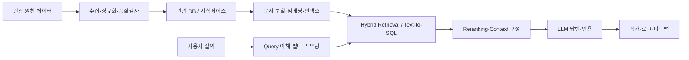

# 🧭 Travel AI Engineering Lab

Python 생태계를 기반으로 **LLM 애플리케이션 엔지니어링 — 검색(Retrieval), RAG, Agent, 평가·운영(LLMOps)** 을 탐구하는 개인 학습·실험 저장소입니다.

관광 도메인의 문제를 직접 구현하고, 같은 문제를 여러 기술로 풀어 **품질·속도·비용을 측정**하며, 기술 선택의 근거와 트레이드오프를 실험 기록으로 검증하는 것을 목표로 합니다.

## Domain

**Travel Knowledge & Assistant — 관광 정보 검색·질의응답·일정 추천**

공공 관광 데이터(한국관광공사 TourAPI 등)를 기반으로 필요한 도메인을 확장합니다. 실제 예약·결제는 다루지 않습니다.

| Domain | Scope |
| --- | --- |
| Knowledge Base | 관광지·음식점·숙박·행사 데이터 수집·정규화, 출처·수집일·라이선스·갱신 이력 관리 |
| Search | 키워드(BM25·한국어 형태소) + 벡터 검색, 지역·기간·카테고리 필터, 리랭킹 |
| Q&A (RAG) | 근거 문서 인용 답변, 근거 부족 시 "확인 필요"로 보류, 멀티턴 |
| Routing | 문서 검색 / 구조화 데이터 질의(Text-to-SQL) / 직접 답변 분기 |
| Agent | tool calling 기반의 제한된 여행 일정 생성 |
| Safety | 직접·간접 prompt injection 테스트, 가드레일, tool 최소 권한 |
| Evaluation | golden query set, 검색·답변 지표 분리 평가, CI 회귀 테스트 |
| Operations | latency·토큰 비용·캐시 적중률·tracing 관측, 모델·프롬프트 버전 관리 |

## Topics & Technologies

아래 항목은 **학습·비교 실험 대상**이며, 모든 기술을 동시에 도입하거나 이미 구현했다는 의미는 아닙니다.

| Category | Technologies |
| --- | --- |
| Language & Tooling | Python, uv, Ruff, Pyright, pytest |
| Concurrency | `asyncio`, `ThreadPoolExecutor`, `ProcessPoolExecutor` |
| Data & Persistence | PostgreSQL, SQLite, Pydantic, psycopg |
| Search | PostgreSQL FTS, BM25(한국어 형태소 분석), Elasticsearch/OpenSearch(nori) |
| Embedding & Vector | 상용 임베딩 API, bge-m3, KURE, sentence-transformers, pgvector, HNSW |
| Reranking | cross-encoder reranker, RRF(Reciprocal Rank Fusion) |
| LLM | LLM API (structured output, streaming, tool calling, prompt caching), 오픈 웨이트 모델(로컬) |
| Agent | 직접 구현 agent loop, LangGraph, MCP |
| App | FastAPI, Streamlit |
| Evaluation | golden set, LLM-as-judge, Ragas 계열 지표, bootstrap 신뢰구간 |
| Performance | `time.perf_counter`, psutil, cProfile·py-spy, locust/k6 |
| Infrastructure | Docker, Docker Compose |
| CI/CD | GitHub Actions |
| Observability | 구조화 JSONL 로그, OpenTelemetry |
| AI & Automation | AI Coding Agents, LLM APIs, MCP |

## Architecture & Design



- **검색과 생성을 분리해서 측정** — Retriever 품질과 Generator 품질을 각각 평가한다.
- **근거 우선 응답** — 출처 없는 사실은 확정적으로 말하지 않는다.
- **교체 가능한 컴포넌트** — chunker, embedder, retriever, reranker, generator, LLM provider를 인터페이스로 분리해 실험 단위로 바꿔 끼운다.
- **LLM 출력은 신뢰할 수 없는 입력** — 스키마 검증·재시도·폴백을 거친 뒤에만 저장·실행한다.
- **Workflow 우선, Agent는 필요할 때** — 고정 흐름으로 풀리는 문제는 workflow로, 판단이 필요한 부분만 agent로 — **필요 조건과 비용을 비교하여 선택적으로 실험**

## Engineering Skills

- **Data Engineering** — 공공 API 수집, 정규화·품질 규칙, 멱등한 적재, 데이터 계보
- **Information Retrieval** — 역색인·BM25, 임베딩 모델 선택, ANN 인덱스 파라미터, 하이브리드 결합·리랭킹
- **RAG & Generation** — chunking 전략, context 구성, 인용·근거성, 보류(abstention) 설계
- **Agent & Tool Use** — 도구 스키마·설명 설계, 실패 처리, 최대 step·예산 제한, human-in-the-loop
- **Evaluation** — golden set 설계, Recall@k·MRR·nDCG, Faithfulness·Answer relevancy, LLM-as-judge 검증(Cohen's κ), pass@k·pass^k
- **Performance & Cost** — 시간·공간 복잡도 실측, p50/p95/p99, TTFT·TPOT, throughput, 토큰 비용·캐시 적중률
- **Reliability & Operations** — rate limit·재시도·백오프, 타임아웃, 관측 가능성, 모델 교체 시 회귀 검증
- **Security** — prompt injection 방어, tool 권한 검증, 비밀정보·개인정보 관리
- **AI-Assisted Engineering** — AI 코딩 도구 활용, 생성 코드 검증, 사용 기록

## Experiments

매 단계 최소 1개의 **"A vs B" 비교 실험**을 진행하고, 결과는 **품질 · 속도 · 비용** 세 축을 한 표에 기록합니다.

| 단계 | 비교 실험 예시 | 주요 지표 |
| --- | --- | --- |
| 기초 | 동기 vs 스레드 vs asyncio 수집 / 전수 벡터 검색 N 스케일링 | p50·p95, throughput, CPU·메모리, 시간복잡도 |
| 기초 | 임베딩 모델 3종 / 구조화 출력 3방식 / 도구 설명 A·B | Recall@k·MRR, JSON 성공률, tool 선택 정확도, pass^k |
| 검색 | BM25 vs 벡터 vs 하이브리드(α 가중합·RRF) / chunking 전략 | Recall@k, MRR, nDCG, 검색 지연 |
| 벡터 | pgvector vs 전용 검색엔진, HNSW `ef_search` 스윕 | ANN recall vs QPS, 인덱스 크기·빌드 시간 |
| RAG | 리랭커 유무 / context 개수 / 프롬프트 버전 | Faithfulness, citation accuracy, TTFT, 요청당 비용 |
| Agent | 직접 구현 vs 프레임워크 / temperature별 신뢰성 | task 성공률, pass@k·pass^k, 평균 step·비용 |
| 운영 | 캐싱 유무 / 모델 라우팅 | p95, goodput, 캐시 적중률, 비용 |

**측정 원칙**
- 평균 대신 **p50·p95·p99** 분포로 기록하고, 워밍업 호출은 분리한다.
- LLM은 비결정적이므로 **같은 입력을 k회 반복**해 성공률과 분산을 함께 본다.
- 평가 문항이 100개 미만이면 **95% bootstrap 신뢰구간**을 함께 적고, 같은 문항끼리 짝지어(paired) 비교한다.
- 데이터셋·모델·프롬프트 버전·동시성 등 **고정 변수를 결과와 함께 기록**한다.

## Roadmap

| Phase | 내용 | 주요 결과물 |
| --- | --- | --- |
| 0. 기초 | 개발 환경·HTTP, 테스트·CI·Docker·SQL, 동시성·성능 측정, 벡터·ML 기초, 임베딩·LLM 원리, LLM API·관측, tool calling·평가 기초 | `bench.py` 측정 모듈, LLM 호출 래퍼·JSONL 로그, eval runner |
| 1. 데이터 | 관광 데이터 모델링, ETL, end-to-end 뼈대 | 스키마·데이터 사전, 적재 파이프라인, `/ask` API |
| 2. 검색 | BM25 → 벡터 검색 → 하이브리드·리랭킹 | golden query set, chunking·검색 방식 비교 실험 |
| 3. RAG·앱 | 인용형 답변, 멀티턴, SQL 라우팅 | 인용형 QA API, 스트리밍 UI, 배포 |
| 4. Agent·안전 | tool use agent, 보안 테스트 | 일정 생성 agent, 공격 테스트 셋, 가드레일 |
| 5. 평가·운영 | 평가 harness, LLMOps | CI 회귀 평가, 비용·품질 대시보드 |

## Approach

**Learn → Build → Experiment → Measure → Document**

단순한 기술 도입보다 **왜 필요한지, 어떤 문제를 해결했는지, 언제 다른 선택이 더 나은지**를 코드·테스트·실험 기록(Experiment Note)과 설계 결정(ADR)으로 설명합니다.

## Getting Started

```bash
uv sync
uv run python main.py
```
